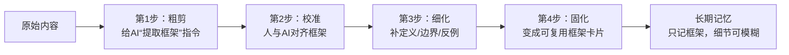

# 提取底层框架提示词


## 核心思路
- **不要一次求完美**：先让 AI 出“骨架草案”，再人工修补。
- **原则**：框架要清晰，细节可模糊；框架可迭代，无需一次成型。

---

## 整体流程：从“一团内容”到“清晰框架”



---

## 通用提示词模板（可直接套用）

### 模板结构

```markdown
你是【角色】。请从下面内容中提取【主题】的“底层框架”。

要求：
1. 框架层次：至少分到 2-3 级（如：模块/子模块/要点）
2. 提取原则：
   - 只抓结构性信息：定义、分类、步骤、因果、对比、关键前提
   - 忽略：案例细节、数据、修辞、个人故事、重复说明
3. 输出格式：
   - 用 Markdown 列表/标题层级呈现
   - 每个节点用短词组，不用长句
   - 顶部用1句话概括框架核心逻辑
4. 约束：
   - 不编造原文没有的内容
   - 不确定处标【待确认】
   - 节点总数控制在 8-15 个

【内容开始】
（粘贴原文）
【内容结束】
```

**微调技巧**：
- 更细：层次改为“3-4 级”
- 更粗：只保留 1-2 级

---

### 示例：提取《个人操作系统》框架

**提示词**（角色+主题+要求） → **AI 输出示意**：

```markdown
# 个人操作系统框架
核心逻辑：以“能力-工具-认知”三层结构支撑 AI 时代的个人进化。

## 1. 内核能力层（Kernel）
1.1 结构化思考  
1.2 判断力  
1.3 表达与影响力  
1.4 跨领域整合  
1.5 学习速度  
1.6 情绪稳定  
1.7 系统化认知  
1.8 AI 驾驭能力  
1.9 社交与信任构建 【待确认】  
1.10 资源整合  
1.11 动手/落地能力  

## 2. 工具与 AI 层（Application）
2.1 AI 工具链（ChatGPT / Notion AI）  
2.2 自动化工具（Zapier / Make）  
2.3 数据分析工具（Excel / PowerBI）  
2.4 创作工具（Canva / 剪映 / Figma）  

## 3. 系统化认知层（Framework）
3.1 时代结构：AI + 算力 + 自动化 + 全球化  
3.2 行业结构：价值链 & 自身位置  
3.3 个人定位结构：角色 × 能力 × 机会  
3.4 决策框架：结构性上升 / 可迁移 / 可被 AI 放大 / 复利
```

---

## 不同场景的提示词微调

### 1. 一篇文章 / 论文
- **抓**：核心问题、论点、子论点、关键概念、论证结构
- **放**：案例、数据、引用、修辞
- **输出**：Markdown 列表，每节点 ≤10 字，顶部 1 句概括推理路径

### 2. 课程 / 散乱笔记
- **层次**：模块 → 单元 → 知识点（3 级）
- **抓**：模块划分、核心问题、关键概念、关键方法
- **放**：闲聊、重复、例子细节
- **输出**：每个知识点 = 词组 + 短定义；合并重复，缺处标【待补充】

### 3. 想法 / 对话 / 会议纪要
- **层次**：阶段 / 维度 / 选项（2-3 级）
- **抓**：问题拆解、判断标准、决策流程、关键权衡
- **放**：情绪、故事、重复
- **输出**：动宾短语或判断句；矛盾处标【矛盾】

---

## 与 AI 校准框架的对话方法

### 删减
- “删掉所有 3 级节点，只保留 1-2 级”
- “合并细碎节点，框架控制在 10 个节点以内”

### 补齐
- “在‘X 层’里，有没有遗漏的点？补进去”
- “把【待确认】根据原文补全，原文没有就删掉”

### 改结构
- “按‘输入-处理-输出’三个阶段重新组织”
- “把‘工具层’拆成‘输入/处理/输出’三个子模块”

### 加元信息
- “每个模块后加括号：该模块解决的核心问题是？”
- “顶部加‘适用场景’和‘不适用场景’各 2-3 条”

---

## 固化：制作可复用框架卡片

### 卡片模板（Markdown / Notion）

```markdown
# 框架：[名称]
- 核心逻辑：一句话
- 适用场景：...
- 不适用场景：...

## 1. [层级名称]
- 节点1
- 节点2
...

## 2. [层级名称]
...
```

### 使用习惯
- 遇到新内容 → 问：“这属于我的哪个框架的哪个节点？”
- 能塞入 → 只更新细节
- 塞不入 → 提炼新框架

---

## 心态：允许细节模糊

- **框架要清晰**：层级、节点、逻辑关系明确
- **细节可模糊**：例子、数据、故事，只要能挂到框架上即可
- **框架要迭代**：先出一版，用几次再修，不追求一次完美

---

